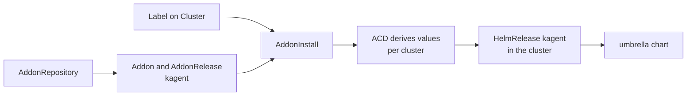

# kagent addon for VKS

[](https://github.com/warroyo/vks-kagent-addon/actions/workflows/test.yaml) [](https://github.com/warroyo/vks-kagent-addon/actions/workflows/release.yaml) [](https://github.com/warroyo/vks-kagent-addon/releases)

## Overview

This repo installs [kagent](https://github.com/kagent-dev/kagent) with its
Agent Substrate runtime on a VKS cluster, as one addon. Label a cluster, and it
gets kagent, the Substrate control plane, gVisor sandboxes for agent code, the
egress gateway that controls what agents can reach, and the database and
object store they need. Nothing is installed by hand per cluster.

It is one helm chart, a bootstrap image used by that chart, and an
AddonConfigDefinition that wires the pieces together for each cluster.

## How it works



- The chart is an OCI artifact on GitHub Packages,
  `oci://ghcr.io/warroyo/vks-kagent-addon/charts/kagent`. An AddonRepository
  registers it with the VKS addon manager, which creates the Addon `kagent` and
  one AddonRelease per version.
- The chart ships its own AddonConfigDefinition (ACD). For each cluster it
  renders the chart's whole values file and derives everything that has to
  agree between kagent and Substrate: service endpoints, identities, the
  database client list and the cluster domain. You never set those.
- An AddonInstall attaches the addon to clusters with the label
  `addons.kubernetes.vmware.com/kagent=enabled`. helm-controller in the cluster
  installs the umbrella chart as the release `kagent`.
- The umbrella chart holds Substrate, the pod certificate controller, kagent,
  PostgreSQL, RustFS and a bootstrap Job. The Job creates the certificate
  authorities and the RustFS credentials, so no plain-text password is stored
  anywhere.
- The ACD also emits a policy that mounts a CA bundle into the egress gateway,
  so agents can reach endpoints with a private CA.

See [Architecture](docs/architecture.md).

## Quick start

Prerequisites:

- VKS with Kubernetes 1.37 on the guest cluster (the chart requires
  `>=1.37.0 <1.38.0`).
- VKS support for helm addons with a custom AddonConfigDefinition (VKS 3.8 or
  later).
- Access to the Supervisor as an administrator for step 1, and as a user of the
  cluster's namespace for the rest.
- A guest cluster that can pull from `ghcr.io` and Docker Hub, and reach
  `storage.googleapis.com` (the gVisor download).

1. Register the addon, once per Supervisor:

   ```sh
   kubectl apply -f install/addonrepository.yaml
   ```

2. Label the cluster:

   ```sh
   kubectl -n my-namespace label cluster my-cluster \
     addons.kubernetes.vmware.com/kagent=enabled \
     addon.addons.kubernetes.vmware.com/helm-controller=managed
   ```

   The first label turns the addon on. The second installs `helm-controller`,
   which helm addons need.

3. Attach the addon to labelled clusters in the namespace. Edit the namespace in
   `examples/addoninstall.yaml` first.

   ```sh
   kubectl apply -f examples/addoninstall.yaml
   ```

4. Optional: set worker pools, storage, a model endpoint or a private CA with an
   AddonConfig named `<cluster>-kagent`. Start from `examples/addonconfig.yaml`
   and see [Configuration](docs/configuration.md).

   ```sh
   kubectl apply -f examples/addonconfig.yaml
   ```

5. Check it:

   ```sh
   kubectl -n my-namespace get clusteraddon my-cluster-kagent
   kubectl -n ate-system get pods     # in the guest cluster
   kubectl -n kagent get pods         # in the guest cluster
   ```

   The ClusterAddon is Ready when every pod in both namespaces is Running.

Agents need a model. See [the FAQ](docs/faq.md#how-do-i-set-up-a-model) for the
ModelConfig and the API key Secret. For problems, see the
[FAQ](docs/faq.md).

## Repo structure

```text
chart/kagent/                    umbrella chart (published to ghcr.io by CI)
chart/addon-config-definition.yaml   source of the chart's AddonConfigDefinition
bootstrap/                       the bootstrap Job (Go) and its Dockerfile
install/addonrepository.yaml     AddonRepository and install (OCI) for registering the addon
examples/                        AddonInstall and AddonConfig
scripts/                         embed-acd.sh, sync-crds.sh, sync-ca-roots.sh
LICENSE                          Apache License 2.0
test/acd/                        renders the ACD and the chart in a Go test
.github/workflows/               test and release
docs/                            see below
```

- [docs/architecture.md](docs/architecture.md): components, names, namespaces,
  the bootstrap Job, egress CA trust, Pod Security, failure modes
- [docs/configuration.md](docs/configuration.md): AddonConfig values and chart
  values
- [docs/development.md](docs/development.md): building, tests, check scripts,
  releasing
- [docs/faq.md](docs/faq.md): operational questions and gotchas
- [docs/decisions.md](docs/decisions.md): design decisions and rejected
  alternatives
- [docs/upstream-workarounds.md](docs/upstream-workarounds.md): what the chart
  carries for upstream problems, and when each can go
